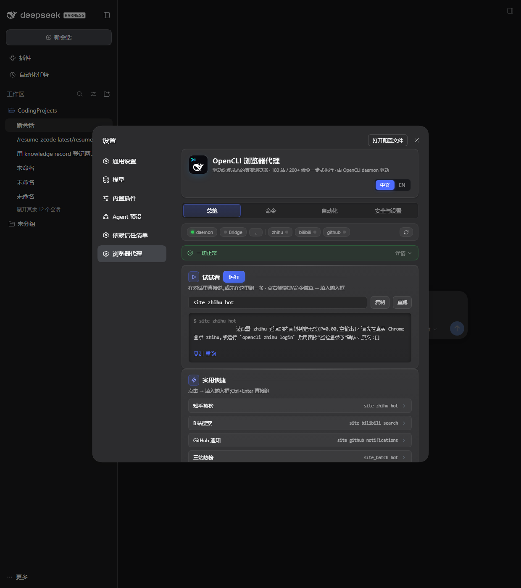
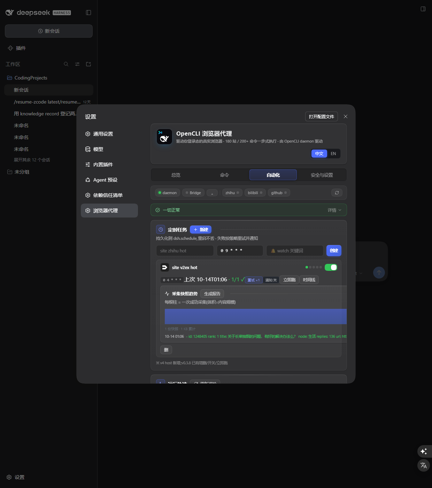
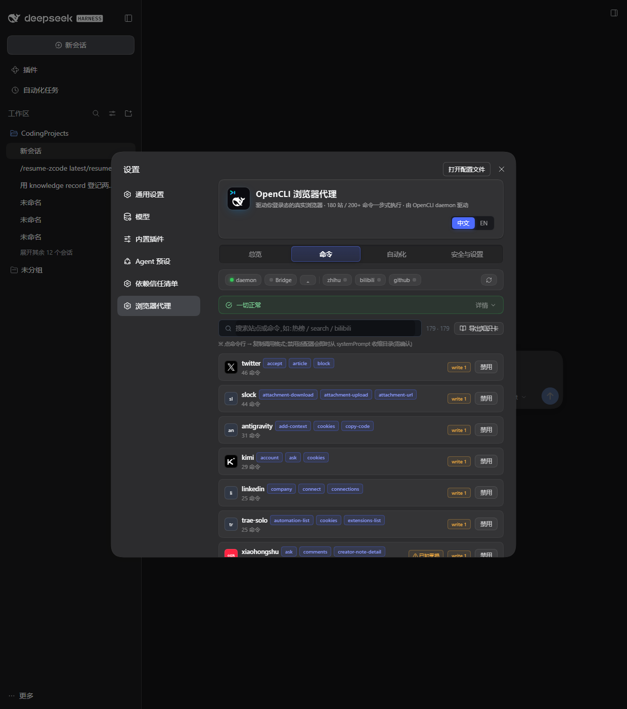

# dsh-opencli · 让你的 dsh 用**你的浏览器**办事

[](https://github.com/awesome-dsh-plugin/awesome-dsh-plugin/tree/main/data/plugins/IKEASven69__dsh-opencli.yml)
[](https://github.com/topics/dsh-plugin)

> Let your DeepSeek Harness agent work in **your logged-in browser**: 知乎/B站/微博/GitHub 等 **180+ 站点一步式命令**,发帖点赞带审批门。

**dsh 自带的 web 工具是"搜索"——所有人拿到一样的匿名结果。这个插件给它补上"办事"的那一半:agent 操纵你自己日常使用的、带登录态的真实浏览器,以你的账号视角拿数据、替你动手(写操作先弹审批,你点了允许才执行)。**

| 在对话里说 | 插件做的事 |
|---|---|
| "B站搜罗翔,总结播放量前 3" | `site bilibili search 罗翔` 一步拿到结构化结果 |
| "知乎热榜前 10 摘要" | `site zhihu hot` |
| "每天早 9 点自动跑热榜,有异常告诉我" | 面板建定时任务,持久化真执行,watch 关键词命中通知 |
| "把这个转发到我的微博" | `site weibo post …` —— **先弹审批窗** |
| "同时拉知乎/微博/B站热榜做对比" | `site_batch` 一条命令三站并行 |
| "打开公司后台把审批单批了" | `browser_open/click` 通用原语,用你的登录态 |

**实测效果(真实登录态,非演示数据):**

| 对话里直接跑命令 | 定时采集 → 快照 → 时间线 → 带出处报告 |
|---|---|
|  |  |

**没适配器的网站?** 180+ 站目录之外,`browser_*` 通用原语覆盖任意网页;agent 还能当场造适配器,越用越会浏览。完整命令目录:



## 30 秒装完

```sh
# ① 装 opencli 并启动(已装过 opencli/OpenCLIApp?跳到 ③)
npm i -g @jackwener/opencli && opencli daemon restart

# ② 装 BrowserBridge 扩展(Chrome/Edge 都行),在浏览器里登录你的常用站点
#    https://github.com/jackwener/OpenCLI/releases → opencli-extension-*.zip → 浏览器"加载解压缩的扩展"

# ③ 装插件
dsh plugin add IKEASven69/dsh-opencli
```

**不想自己动手?把下面这句发给你的 dsh,它替你装完并自检:**

> 请按 https://github.com/IKEASven69/dsh-opencli/blob/opencli-release/AGENT_INSTALL.md 里的步骤帮我安装 dsh-opencli,装完跑一次自检并告诉我结果。

装完打开 dsh 设置 →「浏览器代理」面板:四 tab(总览/命令/自动化/安全与设置)、180 站目录、登录态巡检、daemon 一键修复。

<details>
<summary><b>安装注意事项(3 条,遇到问题再展开)</b></summary>

- ⚠️ 插件目录内跑 `npm install` 会静默把宿主的 opencli 链接替换为 registry 副本([上游 #2555](https://github.com/jackwener/opencli/issues/2555))——请在本仓库外装依赖。
- ⚠️ Windows:dsh shell 走 PowerShell,`DSH_OPENCLI_BIN` 需指向 `.cmd` 结尾的 shim(无扩展名会被静默忽略)。版本管理器(vfox/nvm)切 node 版本后插件会自动扫描各版本目录找回 opencli。
- ⚠️ 升级 dsh 到 0.2 前自查 profile `cordis.patch.yml` 有无引用未安装的 bundle——0.2 对此静默退出。

</details>

---

## 登录态到底是怎么回事(重要澄清)

**本插件不使用、也不需要 dsh 的内置浏览器。**它经 [OpenCLI](https://github.com/jackwener/OpenCLI) 的 daemon + BrowserBridge 扩展,驱动**你扩展装在哪个、就哪个浏览器的真实窗口**(Chrome/Edge 均可)——登录态来自你日常浏览器里的真实会话,和你在地址栏手打网址完全同源。你在哪登录了知乎,agent 就能用你的知乎;巡检面板会告诉你哪些站在线。

## 两张牌:固定命令 × 任意网页原语

模型对每个站有两张牌,**先打第一张,失败自动换第二张**:

1. **固定命令**(`site <站> <命令>`):预编译站点知识,省 token、结果可验证、有失败签名恢复表;
2. **任意网页原语**(`browser_open/state/click/fill` + 只读脚本 + Playwright recipe):适配器没覆盖的页面用登录态自由组合。

动手前先让模型调 `site_knowledge <站>` 读知识卡:全部命令+已知坑+失败恢复表——不现场试错。知识卡可导出 markdown 分享(`~/.dsh/opencli-knowledge/`)。

## 它回答的三个真实缺口

- *"browser agents re-learn every site on every session"*([browser-use#5841](https://github.com/browser-use/browser-use/issues/5841))→ **180+ 站预置结构化命令**:站点知识预编译,不重学。
- *"想在当前打开的 Chrome 实例上做自动化"*([browser-use#4709](https://github.com/browser-use/browser-use/issues/4709))→ **登录态原生**:所有命令跑在你已登录的浏览器里,不另起无头实例。
- *"求结构化动作证据:动作到底改没改页面"*([browser-use#5137](https://github.com/browser-use/browser-use/issues/5137);同源 [BrowserSkill#242](https://github.com/Tencent/BrowserSkill/issues/242))→ **执行真实性层**:采集结果经确定性规则+亚秒决策模型两层判定,`exit 0` 但内容无效会被标"疑似静默失败",无人值守定时任务按失败重试。

## 已经自己装过 opencli,这插件还有什么用

| | 只装 opencli(agent 走 shell) | + 本插件 |
|---|---|---|
| 开局发现 | 模型得先跑 `opencli list`(数 MB 输出) | **蒸馏命令目录已注入 systemPrompt**,第一轮就选对命令 |
| 权限模型 | 需要 shell 权限;写操作裸奔无门 | 一等公民工具 + **write 审批门**(工具层拦截) |
| 只读/受限会话 | 无 shell 就没戏 | 无需 shell,工具照用 |
| 定时采集 | 自己写 crontab + 脚本 + 通知 | 面板建定时任务,持久化 + 真执行 + 运行可见 |
| 管理 | 敲命令 | dsh 设置页:诊断/一键启动/目录浏览/巡检/启停/模式切换 |

两不冲突:深度用法仍可配合官方 opencli 技能,本插件负责工具化、安全与面板。

## 全功能面

| 模块 | 能力 |
|---|---|
| **site 适配器** | 180+ 站 / 200+ 命令,蒸馏目录注入 systemPrompt;`site_batch` 多站并行 |
| **browser 原语** | open/click/type/fill/scroll/state/screenshot/extract/wait/crawl 全套(泛爬带限流) |
| **定时任务** | cron,持久化真执行,重启不丢;失败重试 ×3 + 通知 + 运行历史 |
| **采集快照/时间线** | 成功执行存结构化快照(50 份轮转);时间线趋势+历史;**带出处报告导出**(每节:命令+时间+快照路径,零模型改写) |
| **watch 监控** | 关键词命中 → 通知事件(大小写不敏感) |
| **执行轨迹** | 每条 browser/定时执行落盘 JSONL,面板「运行轨迹」复盘"上次为什么失败" |
| **自动化模式** | read-only / standard / autonomous / unrestricted 四档,接入 `tools/pre-execute` 审批门 |
| **站点健康度** | 上游 issue 实测数据驱动:受损站标注 + browser 兜底提示 |
| **MCP Resources** | dsh 0.2 下站点知识经 `opencli://sites/{site}/knowledge` 暴露 |
| **我的适配器** | 禁用/启用管理,禁用即从 systemPrompt 目录收缩 |
| **登录态巡检** | 面板实时显示各站在线状态(cookie 级诊断) |
| **登录态桥** | 探测 daemon 浏览器 CDP 端点,一键把 dsh 官方 Browser Use 接到你登录态的浏览器 |
| **拦截审计** | 审批门拦截记录(近 7 天计数 + 明细) |
| **限流与限域** | `usagePolicy` + 429/5xx 自动退避;`--authProfile` 限域登录,跨域拒绝 |
| **站点品牌图标** | 48+ 站 simple-icons 官方标 + 品牌色 |
| **中英双语** | 面板 EN / zh 一键切换 |

## 配置

零配置开箱即用;需要微调时:

| 配置 | 方式 | 默认 |
|---|---|---|
| opencli 二进制路径 | 环境变量 `DSH_OPENCLI_BIN`,或插件自带本地依赖 | `opencli`(全局) |
| 写审批开关 | 面板「审批门」一键开关 | 开 |
| 自动化模式 | 面板四档 | standard |
| 限流策略 | `usagePolicy`(minDelayMs 750 / maxConcurrency 2 / burst 3 / cooldown 30s / maxPagesPerRun 20) | 见左 |
| 限域登录 | `authProfiles`(`allowedDomains`/`storageStatePath`),配 `site --authProfile` | 无 |

## 安全设计

- **write 审批门**(默认开):写命令经 dsh 原生审批——弹窗点"允许"才执行;权限不明按写处理(fail-closed)。
- 命令白名单与参数校验;`browser_do` 仅放行只读/创作类子命令。
- 全部输出经截断与噪声剥离,防上下文污染。
- 限流 + 自动退避;限域登录跨域拒绝。

## 已验证的测试矩阵

| 层面 | 方式 | 结果 |
|---|---|---|
| 单元/回归 | vitest ×159(含 cron 回归/空参数护栏/trace/报告结构) | ✅ |
| 全权审查套件 | 21 项真机逐项(渲染/真执行/状态对账/RPC 真值),`full-review.cjs` 一键复测;dsh 0.2.0-rc.2 与 0.2.1-rc.1 双版本通过 | ✅ |
| 真模型 E2E | 会话调 `site zhihu hot`/写拒绝/browser 往返 | ✅ |
| 登录态真数据 | 浏览器扩展桥 → try-run 真实热榜(判定 P=0.91)→ 定时采集 15s 回填 → 快照 → 时间线 → 带出处报告 | ✅ |

## 更新日志

完整版本历史见 [CHANGELOG.md](CHANGELOG.md) 与 [Releases](https://github.com/IKEASven69/dsh-opencli/releases)。

## 定位(不做什么)

- 不替代 OpenCLIApp/daemon/扩展——那是引擎与管家,本插件是 **dsh 里的驾驶舱**;
- 不替代 dsh 内置 web_search/web_fetch——内置管检索,本插件管办事;
- 无头服务器(没有任何真实浏览器的机器)不适用。

MIT License.
